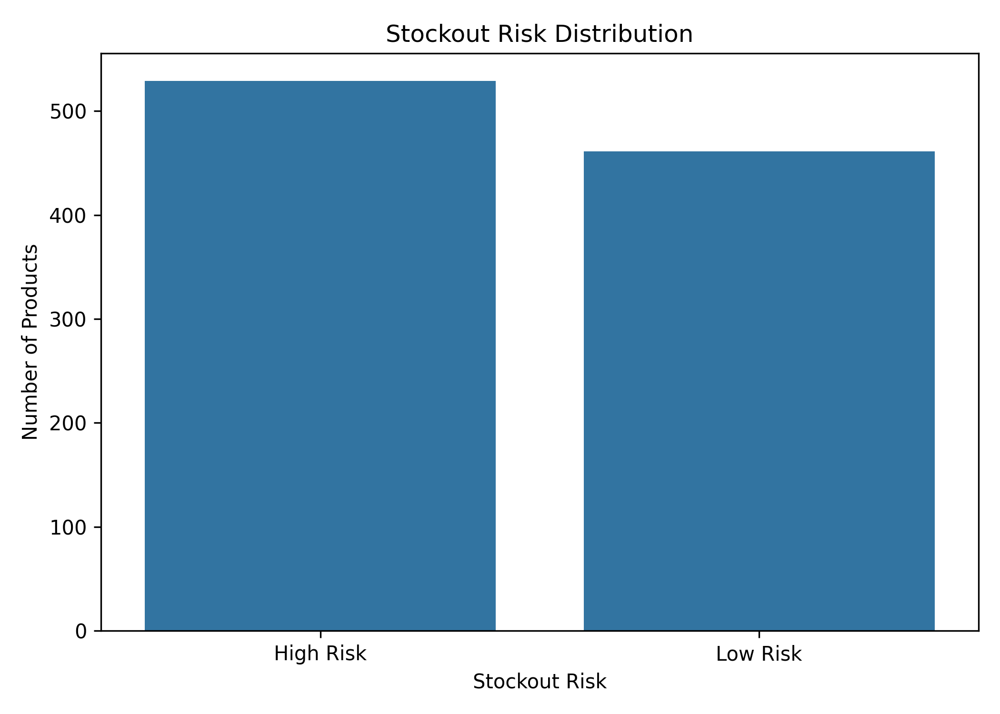
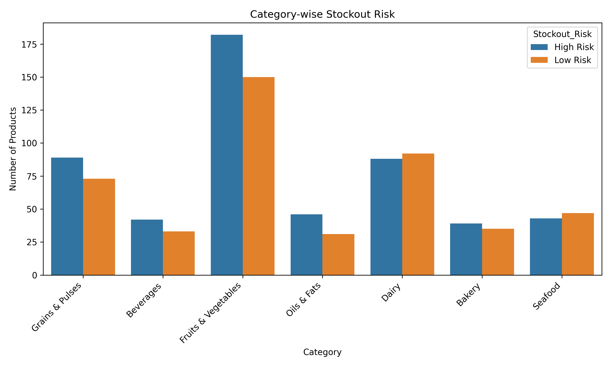
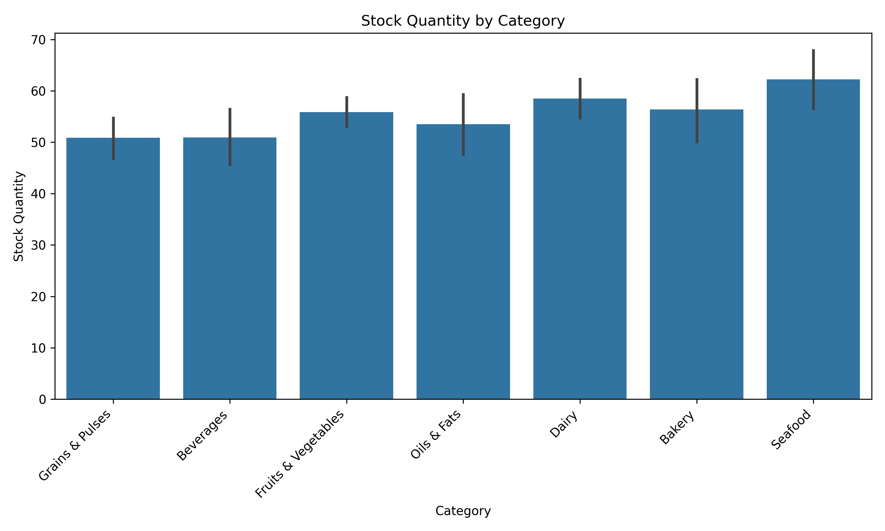

# Retail Inventory & Stockout Risk Analysis

### Python Data Analytics Project

## 1. Project Overview

This project focuses on analyzing retail inventory data to understand stock levels, identify products that may require reordering, evaluate potential stockout risks, and generate data-driven business insights.

Python libraries were used to clean, transform, analyze, and visualize the dataset.

## 2. Project Objectives

- Analyze overall inventory performance.
- Identify products requiring reorder attention.
- Evaluate potential stockout risks.
- Compare inventory across product categories.
- Analyze supplier-wise inventory distribution.
- Examine product expiration dates.
- Identify high-stock and high-sales products.
- Generate actionable business recommendations.

## 3. Tools & Technologies

- Python
- Pandas
- NumPy
- Matplotlib
- Seaborn
- Jupyter Notebook
- Visual Studio Code

## 4. Dataset Description

**Dataset Name:** Grocery Inventory and Sales Dataset

**Dataset Size:** 990 rows and 16 columns.

The dataset contains information related to:

- Product details
- Product categories
- Supplier information
- Stock quantity
- Reorder levels and quantities
- Unit prices
- Product dates
- Warehouse locations
- Sales volume
- Inventory turnover rate
- Product status

## 5. Data Cleaning & Preparation

The following data preparation activities were performed:

- Inspected dataset structure and data types.
- Checked missing values and duplicate records.
- Renamed the `Catagory` column to `Category`.
- Filled one missing category value using product classification as an assumption.
- Removed the dollar symbol from `Unit_Price` and converted it into a numeric data type.
- Converted date columns into datetime format.
- Checked the cleaned dataset for missing values and duplicates.

After cleaning, no missing values or duplicate records remained.

## 6. Exploratory Data Analysis

The project explored:

- Overall inventory performance.
- Category-wise stock distribution.
- Reorder requirements.
- Potential stockout risk.
- Category-wise stockout risk percentages.
- Inventory distribution by product status.
- Product expiration information.
- Supplier-wise inventory analysis.
- Warehouse location analysis.
- Top products by stock quantity and sales volume.
- Correlation between numerical variables.

## 7. Stockout Risk Analysis

A preliminary stockout risk screening was performed by comparing stock quantity with sales volume.

The following rule was applied:

- High Risk: Stock Quantity is less than Sales Volume.
- Low Risk: Stock Quantity is greater than or equal to Sales Volume.

### Risk Distribution

| Risk Category | Percentage |
|---|---:|
| High Risk | 53.43% |
| Low Risk | 46.57% |

A total of 529 product records were classified as High Risk and 461 as Low Risk.

**Note:** Sales volume does not specify a time period in the dataset. Therefore, this classification is a preliminary screening indicator, not a confirmed stockout prediction.

## 8. Key Findings

- 990 product records were analyzed.
- 53.43% of product records were classified as High Risk under the preliminary stock-versus-sales rule.
- Oils & Fats had the highest category-level High Risk percentage at 59.74%.
- Seafood had the lowest category-level High Risk percentage at 47.78%.
- The Discontinued status group contained 18,229 stock units.
- Katz was the supplier with the highest total stock among the suppliers analyzed, with 701 units.
- The warehouse location field contained highly granular locations, limiting meaningful warehouse-level comparisons.

## 9. Business Recommendations

- Review products classified as High Risk before making replenishment decisions.
- Monitor categories with relatively higher preliminary risk percentages.
- Review discontinued product records and investigate remaining inventory.
- Evaluate supplier performance using additional information such as delivery time, cost, and product quality.
- Improve inventory reporting by recording sales periods and stock movement history.
- Validate product expiration dates before making expiry-related decisions.
- Maintain accurate product, supplier, and warehouse information.

## 10. Data Limitations

- The dataset does not specify the time period represented by Sales Volume.
- The available expiration dates are historical relative to the analysis date.
- Some date records show logical inconsistencies, including expiration dates before receipt dates.
- Warehouse locations appear highly granular, limiting warehouse-level aggregation.
- Stockout risk is based on a simple comparison and is not a predictive model.
- One missing category was filled using a product-classification assumption.

Therefore, the findings should be interpreted as exploratory insights from the available sample dataset rather than verified operational results from a real retailer.

## 11. Conclusion

This project demonstrates the practical application of Python for retail inventory analysis.

Using Pandas, NumPy, Matplotlib, and Seaborn, the project examined inventory levels, reorder requirements, potential stockout risks, supplier distribution, and product-related information.

The analysis highlights areas that may require further investigation and demonstrates the importance of data quality, exploratory analysis, and careful interpretation when making business recommendations.

## 12. Project Structure

Retail-Inventory-Stockout-Risk-Analysis/
│
├── Dataset/
│
├── Notebooks/
│   ├── Retail_Inventory_Stockout_Analysis.ipynb
│   ├── Cleaned_Retail_Inventory_Dataset.csv
│   └── Final_Product_Risk_Report.csv
│
├── reports/
│
├── Visualizations/
│
└── README.md

## Project Visualizations

### 1. Stockout Risk Distribution

### 2. Category-wise Stockout Risk

### 3. Stock Quantity by Category

